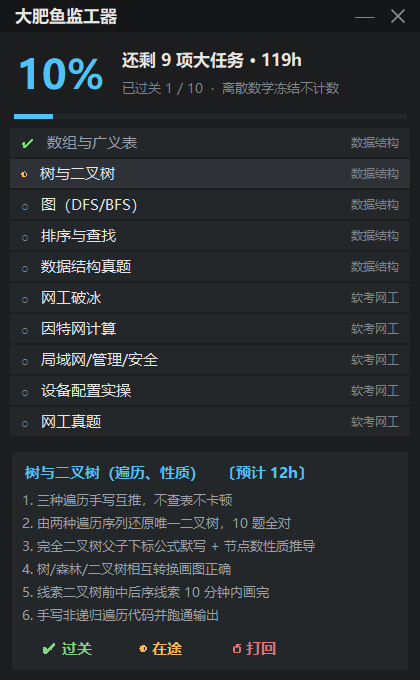
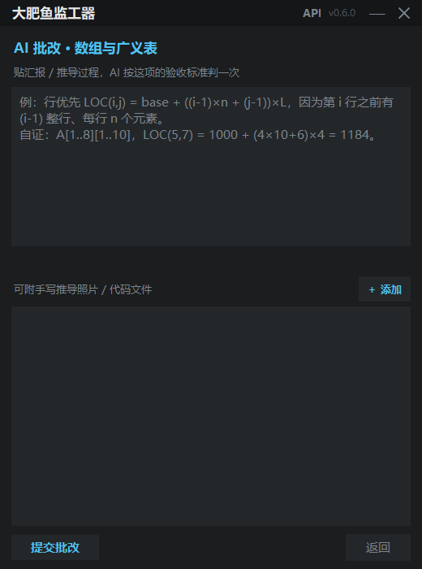
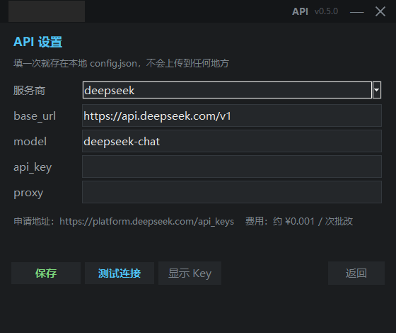

# DaFeiYu · 大肥鱼监工器

**当前版本 v0.6.0** · [变更记录](CHANGELOG.md) · [MIT](LICENSE) · Python 3.8+

一个只管三件事的桌面悬浮窗：**你还剩几项没做、下一项是什么、怎么才算过关。**

不聊学习计划，不谈情绪价值，不预测考试结果。你点「过关」，它才给你加分；你说「还行吧」，它一分不给。



```
420 × 680 · 无边框 · 永远置顶 · 单文件零依赖 · 0 次网络请求
```

---

## 为什么不是 Chrome 插件

做考证监工的第一需求是**挡住你**。Chrome 插件活在浏览器标签页里，而你摸鱼的时候根本不在浏览器，你在微信、在游戏、在 B 站客户端。扩展程序的悬浮窗只能在页面里浮动，它压不住任何一个原生窗口。

所以这里选了最原始也最有效的方案：**Tkinter 无边框置顶窗**。它只有 360 行、零第三方依赖、不用打包、不用装运行时、改一个 JSON 就能换监督对象。Windows 自带 Python 就能起，macOS 和 Linux 同理。

真要做成插件，把它嵌进手机、再顺手推送提醒，那是另一个产品。先把这一项做完。

## 为什么不用大模型算进度

进度计算是**确定性的账**，不该交给概率模型。

- 大模型会把你一句「差不多看完了」理解成 80%，`sum(state == "done") / 10` 不会。
- 大模型每次重新推理都可能算出不同的百分比，本地状态机不会。
- 大模型需要 API Key、要计费、要联网、会断，本地 JSON 不会。

**大肥鱼的人格（提示词）负责「怎么说」，这个程序负责「算多少」。** 两件事分开，各自都可靠。提示词见 [`prompts/dafeiyu-system-prompt.md`](prompts/dafeiyu-system-prompt.md)，可以粘进任何 LLM 单独使用。

## 核心设计：三态，不是勾选框

| 态 | 含义 | 计入完成度 |
|---|---|---|
| `○ 待完成` | 没碰过 / 被打回 | 否 |
| `◐ 在途` | 学了一半、「感觉差不多」 | **否** |
| `✔ 已过关` | 全部硬性验收标准达标 | 是 |

「学过」「看过」「报课了」都不算过关。`◐ 在途` 存在的唯一意义，是让你诚实标注自己的进度——它在总进度里**永远显示为 0**。

任何一项都随时可以点 `↺ 打回`，退回 `待完成`，百分比立刻掉下去。这是整个项目的中心思想：**没有防回退的进度条，只是安慰剂。**

## 学习过程记录：它管的不只是结果

打卡只记「做没做完」，看不出你这三天是在学还是在刷手机。所以每次学习可以按 `▶ 计时` 开始，结束时填两行：**用时** + **学到哪 / 卡在哪**。

记录进 `dafeiyu_state.json` 的 `sessions`，详情区立刻显示 `已投入 1.2h / 预算 4h · 2 次学习记录`。时间开始和任务预算挂钩，而不是只在最后打个勾。



**AI 批改会读这些记录。** 最近 3 次会话会一起发过去，所以它能看出「你只看了视频、一次练习都没做」这种模式 —— 光看汇报文字是看不出来的。

**附件直接上传。** 手写推导拍照就能发：点 `＋ 添加` 选图片（png/jpg/webp/bmp/gif）或代码文件（txt/py/c/cpp/java/cs/json/csv）。图片走多模态，文本直接读入。

需要一个能读图的模型：`qwen-vl-max`、`glm-4v-flash`、`gpt-4o-mini` 都行。程序会先判断当前模型是否支持视觉，不支持就明确告诉你换哪个，而不是发出去白等一次超时。

## AI 批改（可选功能）

不配 API Key 也能用全部核心功能 —— 记账、打卡、工时、打回一样不落。想要第二双眼睛判你的作业，才需要这一步。

配好后，点 `AI 批改` 把推导贴进去，模型按**这项的验收标准**回四行：判定 / 漏洞 / 依据 / 建议。判定规则里写死了三条：没过程没数字一律打回、只给结论不给推导打回、态度再好也不给通过。

**AI 判通过也不会自动过关。** 进度始终只由你点「✔ 过关」决定 —— 批改是第二双眼睛，不是替你负责的人。

三分钟接入，[完整引导见 docs/API_SETUP.md](docs/API_SETUP.md)：五家服务商对比（DeepSeek 一次批改约 ¥0.001）、拿 Key 的步骤、报错对照表、隐私边界。



```json
// config.json（首次启动自动生成，已 gitignore）
{ "base_url": "https://api.deepseek.com/v1", "model": "deepseek-chat",
  "api_key": "sk-...", "proxy": "", "system_prompt": "" }
```

`system_prompt` 留空用内置监工人格，写自己的就换语气。**任何 OpenAI 兼容接口都能接**。

## 安装与快速开始

**方式一：下载 exe（不用装 Python）**

从 [Releases](https://github.com/wenzi4055/DaFeiYu-Study-Assistant/releases) 拿 `DaFeiYu.exe`（约 9 MB，单文件），丢到任意文件夹双击即可。首次运行会在 exe 旁边自动生成 `tasks.json` 和 `dafeiyu_state.json`。

**方式二：跑源码**

需要 Python 3.8+（Windows 装 Python 时勾选 tcl/tk，默认就带）。

```bash
git clone https://github.com/wenzi4055/DaFeiYu-Study-Assistant.git
cd DaFeiYu-Study-Assistant
python dafeiyu.py
```

也可以直接双击 `dafeiyu.py`。

**方式三：自己打包**

```powershell
.\build.ps1        # 产物 dist\DaFeiYu.exe
```

- 拖标题栏移动，双击标题栏折叠成一条 32px 的进度带
- 点任意任务看它的**全部硬性验收标准**（在下方滚动可翻）
- `✔ 过关` / `◐ 在途` / `↺ 打回` 三键切换
- `Esc` 展开
- 任务多到装不下时，列表区支持鼠标滚轮

## 改成你自己的任务池

**不用改代码。** 程序旁边的 `tasks.json` 就是任务池，改它就行：

```json
{
  "title": "监督器标题",
  "note": "进度下方的一句补充",
  "unit": "项大任务",
  "tasks": [
    { "id": "ds1", "module": "数据结构", "short": "数组与广义表",
      "full": "数组与广义表 · 重建", "hours": 4,
      "criteria": ["验收标准一", "验收标准二"] }
  ]
}
```

- 只认 `tasks` 数组，**几项都行**：进度分母自动等于任务数，3 项、30 项都能跑
- `hours` 是该任务的预计投入工时，程序用它算「还剩多少小时」；不填按内置表兜底，再没有就记 0
- 字段全部可选：缺 `short` 回退 `full`，缺 `criteria` 会在详情区提示你补
- 换监督对象不需要改代码：把 `title` 改成「健身监督器」、`unit` 改成「项训练」，就是另一个监工
- `tasks.json` 损坏或缺失时会自动回退内置的示例任务池，程序不会起不来
- 文件模板见 [`tasks.template.json`](tasks.template.json)，三科完整示例见 [`tasks.example.json`](tasks.example.json)

桌面上的 `dafeiyu_state.json` 只按 id 记状态，改任务池不会丢进度（匹配不上的旧 id 由新定义覆盖）。

**写验收标准的原则：可当场判定真假。** 「掌握二叉树遍历」是废话，「由两种遍历序列还原唯一二叉树，10 题全对」才能判。题库从哪来是你的事，程序只认结果。

## 配套试卷（示例）

`exams/` 下是 DS-1（数组与广义表）的验收自测卷和答案判分细则，可以作为你给自己出卷的模板：

- [试卷](exams/数据结构-DS1-数组与广义表-试卷.md) —— 15 题 100 分，限时 25 分钟
- [答案与判分细则](exams/数据结构-DS1-数组与广义表-答案与判分细则.md) —— 逐题得分点、常见错法、糊弄识别清单

关键在第二份文件：**没有判分细则的卷子只是练习，不是验收。** 得分点要写到"漏了哪一步扣几分"，否则 90 分这条线就是自己骗自己。

## 通用监督模板（人格版）

程序是壳，`tasks.json` 是任务，[`prompts/supervisor-template.md`](prompts/supervisor-template.md) 是**人格**。三者可以分开用：

- 只想要个不会哄你的监督人格 → 填空后粘进任意 LLM
- 想换监督对象（健身、毕设、写作进度）→ 改 `tasks.json` 的 `title` / `unit` / `criteria`
- 想要常驻桌面的记账窗 → 用这个程序

模板里有填空区、三态规则、防糊弄清单，以及「我还在学习阶段」这类拖延该怎么处理（答案：给 48 小时时间盒，到期自动进考场，不许顺延）。

## 工时估算与排期

进度条只回答「做了几项」，不回答「还要多久」。所以每一项都带 `hours`，窗口里两处会用到它：

- 顶部：`还剩 9 项大任务 · 119h` —— 剩余工时是**未过关项**的小时数之和，打回一项就涨回去
- 详情区：`树与二叉树（遍历、性质） 〔预计 12h〕`

工时怎么估出来的、周计划怎么排、里程碑在哪几个日期，见 [学习排期表](plan/学习排期表.md)：总账 123 小时，按每天 2 小时排 12 周，含一站最容易失守的检查点（子网划分，M5）。

**估算方法是可以复核的：**

```
单项工时 = 内容总量 ÷ 你的实际速度 × 练习系数(1.2~1.5) + 测试 1~2h
```

「实际速度」要自己测一次——拿一节录播计时看完，记下分钟数，再乘总节数。这一步 20 分钟，能让整张表从猜测变成你的真实数据。

## 文件结构

```
dafeiyu.py                   主程序（界面 + 记账），单文件
aiclient.py                  AI 批改客户端（OpenAI 兼容，零依赖）
build.ps1                    一键打包 exe
tasks.json                   你的任务池（首次运行自动生成，不进版本库）
tasks.template.json          任务池骨架
tasks.example.json           三科完整示例
config.json                  你的 API 配置（自动生成，不进版本库）
config.example.json          API 配置示例
dafeiyu_state.json           你的进度账本（不进版本库）
plan/                        学习排期表：工时估算、周计划、里程碑
exams/                       配套试卷与判分细则（示例）
docs/
  API_SETUP.md               API 接入引导（五家服务商、报错对照、隐私）
  preview.png                截图
prompts/
  supervisor-template.md     通用监督人格模板
  dafeiyu-system-prompt.md   三科专用提示词
tests/test_generic.py        通用性回归测试（任意任务池都能驱动窗口）
```

跑测试：

```bash
python tests/test_generic.py
```

## 进度数据

`dafeiyu_state.json`，纯文本，随程序自动生成和保存，格式如下：

```json
{
  "updated": "2026-11-01 08:43",
  "tasks": {
    "ds1": { "state": "done",  "ts": "2026-11-01 08:12" },
    "ds2": { "state": "doing", "ts": "" }
  }
}
```

想手改也行，改完重开程序即生效。这个文件默认在 `.gitignore` 里——它是你个人的账本，不该进版本库。

## 命令行

```bash
python dafeiyu.py            # 正常启动
python dafeiyu.py --smoke    # 自检：0.8 秒后自动退出（CI / 验证用）
```

## 常见问题

**窗口被别的软件盖住？** 它用的是 `-topmost`，盖不住通常是那个软件自己也在置顶抢答。全屏游戏和无边框全屏会压过它，这是系统行为。

**想要玻璃透明感？** 把 `ALPHA = 1.0` 改成 `0.92`。代价是底下的窗口内容会透上来，深色背景下会看见残影，所以默认给的是不透明。

**任务池放了别人的付费课表算侵权吗？** 章节标题（「第 6 章 因特网」「树与二叉树」）是考纲级别的公共表述，没问题。把付费课程的讲义正文、题库原题、讲义截图塞进仓库就有问题了。这个仓库里没有考点内容，只有任务名和验收标准的写法。

**能不能接大模型、接联网搜索、接手机推送？** 能，那是另一条产品线。先把这一项做完——这正是它要解决的问题。

## 版本与变更

**当前版本 `0.4.0`。** 每次改动按语义化版本记录在 [CHANGELOG.md](CHANGELOG.md)，分「新增 / 修复 / 已知问题」三段——**已知问题也是记录的一部分**，藏起来的问题下次还会咬人。

查版本号：

```bash
python dafeiyu.py --version    # 或看窗口标题栏右上角
```

报问题时先说版本号，否则没法定位。

**发版流程（缺一步都不算发版）**

```
改 __version__ → 更新 CHANGELOG → 拆开提交 → 打 tag → 打包 exe → Release 挂附件
```

**提交规范**

```
类型(范围): 说明
```

类型只用五个：`feat` 新功能 / `fix` 修 bug / `docs` 文档 / `chore` 杂务 / `refactor` 重构。

**一个提交只做一件事。** 工时估算、排期表、README 更新是三件事，就该是三个提交，不要塞进同一个。好处很实际：出问题时能单独回滚，`git log` 读起来是变更史而不是流水账。

## 免责

这是一个进度记账工具，不提供任何考试资料、不承诺任何考试结果。`◐ 在途` 和 `✔ 已过关` 的判定权只在你手里，程序不负责替你判断自己有没有学好。

## License

[MIT](LICENSE)
